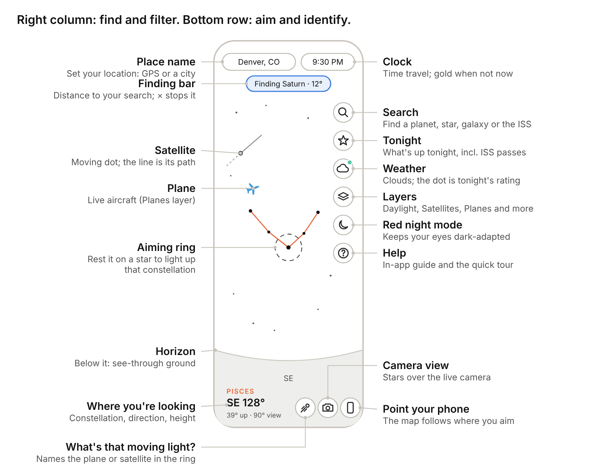

# Night Sky Finder

**Open the app:** [nightskyfinder-app.github.io/night-sky-3](https://nightskyfinder-app.github.io/night-sky-3/) · a beginner's guide to using it is below. Version 2 is still at [night-sky-2](https://nightskyfinder-app.github.io/night-sky-2/).

## What it is

Night Sky Finder is a map of the sky above you right now. It shows the stars, planets, Moon, constellations, galaxies and star clusters in their real positions for your location and time, plus satellites, the space stations and live planes. Tap anything to learn what it is.

It runs in two places. Everything on the map works in both, but phone features and live data only work from your own website.

| Feature | Inside Claude | Your GitHub site |
| --- | --- | --- |
| Sky map, search, Tonight, time travel, info cards, Daylight slider, Help | Yes | Yes |
| Point your phone at the sky, camera view | No, drag instead | Yes |
| GPS location | No, pick a city | Yes |
| Satellites, weather and planes | No | Yes |
| Works with no signal | No | Yes, after first visit |
| Home-screen icon | No | Yes |

If you're stargazing outside, use your GitHub site. Use the Claude version for planning at a desk.

## New in version 3

- **Help and a quick tour.** A **?** button opens an in-app guide, and a short tour shows you around the first time you open the app.
- **Daylight slider.** In daytime the sky turns blue. Slide Daylight down in Layers to see the stars and planets behind it.
- **Weather.** Current conditions and an hour-by-hour stargazing rating for tonight.
- **Satellites.** The space stations, Hubble and about 150 of the brightest satellites, with their paths, plus space station passes in Tonight.
- **Planes.** Live aircraft as a layer you can turn on (needs a one-time setup, below).
- **What's that moving light?** Identifies the plane or satellite in the center ring.
- **Fix direction.** Line the map up with the Moon or a bright planet if your compass is off.

## The screen at a glance

The right-hand column holds Search, Tonight, Weather, Layers, red mode and Help. The three bottom-right buttons are What's that moving light, camera view and phone pointing. Tap anything in the sky itself to learn about it.

## Help and the quick tour

The first time you open version 3, a short tour points out each button. Tap **Next** to step through it or **Skip** to close it.

Tap the **?** button (bottom of the right-hand column) any time for the in-app guide. It has short answers for every feature, a **Take the quick tour** button to replay the tour, and a link to this full guide.

## Looking around

Drag the sky with one finger to turn and tilt your view; pinch to zoom.

- **Drag** left and right to turn, up and down to look higher or lower. On a computer, drag with the mouse or use the arrow keys.
- **Pinch** to zoom in on a small area or out to see half the sky. On a computer, scroll the mouse wheel or press + and −.
- **Point your phone** instead of dragging: tap the phone button (bottom right) and hold the phone up toward the sky. The map follows wherever you aim, in portrait or landscape. Tap the button again to go back to dragging.
- **Look below the horizon** by dragging down past the ground line. The ground is see-through, so you can see the stars on the other side of the Earth, shown dimmer. Straight down is marked NADIR; straight up is ZENITH.

The faint ring in the middle of the screen is your aiming point. Rest it on any star that belongs to a constellation and that constellation's lines fade in, its stars brighten, and its name appears at the bottom left. Move away and they fade out.

The bottom-left readout tells you where you're looking: compass direction (SE 128°), how high (39° up), and how wide your view is (90° view).

## Daytime: seeing behind the daylight

During the day the map shows a blue sky, just like outside, and only the Sun, Moon and brightest planets show through.

To see what's up there anyway:

1. Tap **Layers** (stacked squares).
2. Slide **Daylight** to the left. The blue fades away and the stars, planets and constellations above you appear.
3. Slide it all the way right (it reads **Real**) to get the true sky back.

At dusk and dawn the slider fades the twilight the same way. Your setting is remembered.

Never point binoculars or a telescope at the Sun.

## Finding things

To find something by name, tap the magnifying glass and type; to learn about something you can see, tap it.

**Search**

1. Tap the magnifying glass (top of the right-hand column).
2. Type a few letters: a planet (Saturn), a star (Vega), a constellation (Orion), a galaxy or nebula (Andromeda, M42), a meteor shower (Orionids), or a satellite (ISS, Tiangong, Hubble).
3. Tap a result. Each one says whether it's up now or below the horizon.

The map glides to it and circles it with a pulsing gold ring. A gold "Finding…" bar at the top shows how far away it is. Tap the × on that bar to stop. If a satellite is below the horizon, a message tells you when its next visible pass starts.

**Following the gold arrow**

When the object is off screen, a gold arrow at the edge points the way, labeled with its name and distance in degrees. Turn or drag toward the arrow until the ring appears. This is most useful with phone pointing on: just follow the arrow with your phone. It works for moving things too, like the ISS or a plane.

**Info cards**

Tap any star, planet, galaxy, cluster, constellation name, satellite or plane and a card slides up. It shows:

- A picture: the Moon's actual phase, Jupiter's four moons where they really are tonight, Saturn's real ring tilt, a constellation's figure, or a drawing of a galaxy, nebula, satellite or plane.
- Where it is, when it rises and sets (or a satellite's next visible pass), how bright it is, and how far away.
- A short note, including whether you'll need binoculars or a telescope.
- **Point me there**, which starts the gold finder.
- **About \[constellation\]** on star cards, which opens that constellation's story.
- **Use it to fix direction** on the Moon, bright planets and bright stars, when phone pointing is on (see Phone tips).
- **Read more on Wikipedia**, or satellite details on Heavens-Above, or the plane on a live flight map.

Tap the × or anywhere on empty sky to close the card.

## Tonight

The star button (second in the right-hand column) opens "What's up tonight": a ready-made viewing plan for your location. It also opens by itself the first time you use the app each day.

It lists, in order:

- **Sunset, sunrise, and when it's fully dark.** Faint objects need full darkness.
- **Stargazing rating** from the weather forecast, with the best stretch of the night. Tap it for the hour-by-hour details.
- **The Moon:** its phase, rise and set times, and a warning when its light will wash out faint galaxies.
- **Planets you can see,** with the hours they're up and when and where they're highest.
- **Close pairings,** such as the Moon passing near Jupiter.
- **Eclipses** in the next few weeks.
- **Space stations:** visible passes of the ISS and China's Tiangong station tonight (and Hubble, if it ever rises high enough where you are), with when and where each one appears, how high it gets, and when it fades.
- **Meteor showers** happening now, when they peak, and the best time to watch.
- **The best galaxies, nebulae and clusters** to try, high in the sky after dark.

Tap any row marked FIND and the app takes you straight to it. Close the panel with the × at top right.

## Weather

The cloud button (third in the right-hand column) shows the weather for your location and how good tonight looks for stargazing. The small dot on the button is tonight's rating: green is great, light green good, yellow fair, red poor.

The weather panel shows:

- **Right now:** temperature, conditions, cloud cover (low, middle and high clouds), humidity, wind, visibility and the chance of rain.
- **Stargazing tonight:** a rating (Great, Good, Fair or Poor), the best stretch of the night, and a bar for each dark hour. Taller, greener bars are better; the number above each bar is the cloud cover.

The rating looks at clouds most (thin high clouds count less than thick low ones), then haze, humidity, rain and moonlight. It only covers the hours when the sky is properly dark.

Use the °F / °C button to switch units, and **Refresh** to fetch the latest forecast. The forecast updates by itself every 30 minutes while the app is open, and the last one is kept for when you have no signal. Weather data comes from Open-Meteo.

## Satellites and the space station

Satellites appear as small dots with a short line showing their path: dashed where they've been, solid where they're going.

- A **bright white dot** is sunlit and can be seen with your eyes.
- A **faint ring** is in Earth's shadow, or the sky is too bright, so you can't see it right now.
- The **ISS**, **Tiangong** and **Hubble** are always labeled. Others are labeled when they're visible or when you zoom in.

**When to look:** in the first two hours after sunset and the two hours before sunrise. That's when your sky is dark but satellites overhead are still in sunlight. In the middle of the night most are in Earth's shadow.

**What they look like:** a steady star gliding across the sky in a few minutes. Satellites don't blink; planes do. The ISS is the brightest, brighter than any star.

The app downloads orbit data about once a day (it doesn't send your location for this). With no signal it keeps using the last download for a while; after about a week positions start to drift, and the card says so.

Turn satellites on or off with **Satellites** in Layers.

## Planes

Turn on **Planes** in Layers to see live aircraft as small blue plane shapes pointing the way they're flying, labeled with their flight number (and altitude when you zoom in). Tap one for its altitude, speed, heading, aircraft type and registration, plus a link to a live flight map.

Planes show live only, so they're hidden while you time travel. While the layer is on, the app asks for planes in your area every 10 seconds.

**One-time setup.** Free flight-data services don't accept requests straight from a web page, so planes go through a tiny free relay that you set up once on Cloudflare. It takes about 10 minutes and doesn't need a credit card.

1. Go to **dash.cloudflare.com** and sign up for a free account.
2. In the menu on the left, open **Workers & Pages** (it may be under **Compute**), then choose **Create**, then **Create Worker** (or "Start with Hello World").
3. Name it something like **night-sky-planes** and click **Deploy**.
4. Click **Edit code**. Delete everything in the code box, then paste in the whole contents of **plane-relay.js** from this project. Click **Deploy** again.
5. Copy the Worker's address. It looks like `https://night-sky-planes.yourname.workers.dev`.
6. Check it: open that address in your browser. It should say "Night Sky Finder plane relay is running."
7. In the app, open **Layers**, turn on **Planes**, paste the address into the box and tap **Save**. Planes appear within a few seconds.

Do step 7 on each phone or computer you use. Cloudflare's menu names change now and then, so they may not match exactly.

Plane positions come from ADS-B radio signals that aircraft broadcast, collected by volunteers (adsb.lol, with airplanes.live and adsb.fi as backups). Small planes and some military aircraft may not appear.

## What's that moving light?

1. Point your phone so the moving light sits in the center ring (or drag the map there).
2. Tap the **moving-light button** (bottom row, left of the camera).
3. A card opens for the plane or satellite nearest the ring.

If nothing is near the ring, the app tells you. If the light isn't moving at all, tap it on the map instead: it's a star or a planet. Satellites and Planes need to be on in Layers for this to find them.

## Time travel

Tap the clock (top right) to see the sky at any other time.

- **Slider:** drag to move up to 12 hours earlier or later.
- **−1 day, −1 hr, +1 hr, +1 day:** jump in steps. Use the day buttons to plan a different night.
- **Play:** runs the sky forward at 15 minutes per second, so you can watch stars rise and set. Tap again to pause.
- **Now:** returns to the present.

While you're away from the present, the clock turns gold and shows the date. Tonight, search, info cards and satellites all follow the time you picked, so you can check, for example, where Saturn will be at 10 PM next Friday. Planes stay live only, and weather covers the next few days.

Times are shown in your phone's time zone. If you pick a city in another time zone, times still read in yours.

## Layers

The stacked-squares button (fourth in the right-hand column) controls what the map shows. Your choices are remembered.

| Setting | Options | What it does | Tip |
| --- | --- | --- | --- |
| Daylight | Real to Off | Fades the daytime (or twilight) sky so you can see what's behind it | Real matches what you see outside |
| Sky brightness | City, Suburb, Dark | Shows only the stars you could actually see from that kind of sky | Pick what matches where you're standing; Dark shows about 8,800 stars |
| Constellation lines | Off, Aim, All | Aim draws a figure when the center ring rests on one of its stars | Aim keeps the map clean; All is good for learning shapes |
| Ground | See-through, Solid | See-through lets you look below the horizon | Solid matches what you can really see |
| Constellation names | On, Off | Faint labels for all 88 constellations |  |
| Star names | On, Off | Names of the brighter stars |  |
| Galaxies, nebulae & clusters | On, Off | Symbols for 131 deep-sky objects; the panel shows a key | Galaxy = pink oval, nebula = green square, cluster = gold circle |
| Milky Way | On, Off | The soft glow of our galaxy | Brightest from a dark site in summer and early fall |
| Twinkle | On, Off | Stars shimmer, more near the horizon | Turn off if motion bothers you |
| Height grid | On, Off | Rings every 30° above and below the horizon | Helps judge how high to look |
| Satellites | On, Off | Space stations, Hubble and bright satellites | On by default |
| Planes | On, Off | Live aircraft nearby | Needs the one-time setup above |
| Weather | On, Off | Forecast and stargazing rating | Off means no location is sent for weather |

## Phone tips

These work from your GitHub site, not inside Claude.

- **Set your location first.** Tap the place name (top left), then **Use GPS**, or pick the nearest city. Everything depends on this.
- **Camera view:** tap the camera button (bottom right). Your phone asks for camera permission; allow it. Stars, labels and planets are drawn over the live camera. If they sit a little off from the real thing, pinch to resize until they line up. The app remembers that setting.
- **Calibrate the compass** if directions look wrong: wave your phone in a slow figure-8 a few times. Stay a few feet from cars, metal railings and speakers, which throw compasses off.
- **Fix direction with something real** if the map is still shifted left or right. With phone pointing on, open **Help**, then **Pointing your phone at the sky**, then **Fix direction with the Moon or a bright planet**. (Or tap the Moon, a bright planet or a bright star and choose **Use it to fix direction**.) A gold arrow leads you to it. Hold the phone so the real object sits in the center ring and tap **Lined up**. The app corrects itself and remembers the fix for 12 hours. Reset it from the same Help section.
- **Portrait or landscape** both work. Tilting the phone sideways tilts the view to match.
- **Red night mode:** tap the moon button in the right-hand column. It turns the whole screen red so your eyes stay adjusted to the dark. Turn your phone brightness down too.
- **Give your eyes time.** It takes about 20 minutes in the dark to see the faintest stars.

## Install it and use it offline

Open your GitHub site once with a signal, add it to your home screen, and it works anywhere after that, even with no service.

1. Open nightskyfinder-app.github.io/night-sky-3 on your phone.
2. **iPhone:** in Safari, tap **Share**, then **Add to Home Screen**. **Android:** in Chrome, tap the **⋮** menu, then **Install app**.
3. Open it from the new icon. It runs full screen like a regular app.

The app saves itself on your phone the first time it loads. At a dark site with no signal, it still opens, with every star, planet and calculation working. Satellites use the last orbit download and the weather panel shows the last forecast; planes need a signal. When you're back online, it picks up any updates automatically the next time you open it.

If you had version 2 on your home screen, add version 3 as a new icon. Both can live side by side.

## Privacy

- Your exact location stays on your phone.
- **Weather** sends your location rounded to a tenth of a degree (a few miles) to Open-Meteo.
- **Planes** send the same rounded location to your own Cloudflare relay, which passes it to the flight-data service.
- **Satellites** don't send any location: everyone downloads the same orbit file.
- There's no account and nothing is tied to your name. Like any website, these services can see your internet address.
- Turn Weather or Planes off in Layers to stop sending anything.

## Troubleshooting

| Problem | Fix |
| --- | --- |
| Phone pointing or camera says it can't work | You're in the Claude version. Open your GitHub site instead. |
| The map points the wrong way | Wave the phone in a figure-8 to calibrate the compass, and move away from metal. Still off? Use **Fix direction** in Help. |
| Stars don't line up with the camera | Pinch to resize the view until they match. |
| The sky looks wrong for where I am | Tap the place name (top left) and set your location. |
| The clock is gold and times look off | You're time-traveling. Tap the clock, then **Now**. |
| The sky is blue and I can't see stars | It's daytime. Slide **Daylight** down in Layers. |
| Very few stars show | Sky brightness may be set to City, or it's still twilight. Check Layers, or wait until fully dark. |
| Galaxy and cluster symbols are missing | They hide until the sky is dark. Also check that Galaxies, nebulae & clusters is on in Layers. |
| Constellation lines never appear | Set Constellation lines to Aim or All in Layers, then rest the center ring on a bright star. |
| No satellites show | Check Satellites is on in Layers and read the line under it. Orbit data needs a signal once a day. Most satellites are only visible near dusk and dawn. |
| Planes say "Needs a one-time setup" | Follow the setup steps under Planes, then paste the address in Layers. |
| Planes say "Couldn't reach the plane relay" | Check the address in Layers matches your Cloudflare Worker, and open it in a browser to see that it's running. |
| The weather panel says it couldn't get the forecast | You're offline, or Weather is off in Layers. Tap **Refresh** when you have a signal. |
| The Tonight panel closed | Tap the star button in the right-hand column. |
| I want to see the tour again | Tap **?**, then **Take the quick tour**. |
| The site shows the old version | Close the app or tab completely and reopen it. |
| The site says 404 | Wait two minutes after uploading, and check that index.html is at the top level of the repository and GitHub Pages is turned on. |

## Plain-English glossary

| Term | Meaning |
| --- | --- |
| Magnitude (mag) | How bright something looks. Lower is brighter: Venus is about −4, the ISS up to about −4, the faintest stars you can see from a dark site about 6.5. |
| Degrees (°) | How far apart things are on the sky. Your fist held at arm's length covers about 10°. |
| Direction (azimuth) | Compass bearing: 0° north, 90° east, 180° south, 270° west. |
| Height (altitude) | Angle above the horizon: 0° on the horizon, 90° straight overhead. Negative means below the horizon. For planes, "altitude" on the card means feet above sea level. |
| Zenith / Nadir | Straight up / straight down. |
| Constellation | One of 88 official regions of the sky, each with a traditional star pattern. |
| Deep-sky object | Anything beyond our solar system that isn't a single star: galaxies, nebulae and star clusters. |
| Messier object (M31, M42…) | One of 110 bright deep-sky objects listed by Charles Messier in the 1700s; great first targets. |
| Galaxy | A separate system of billions of stars, far beyond the Milky Way. |
| Nebula | A cloud of glowing gas and dust, often where stars are being born. |
| Open / globular cluster | A loose group of young stars / a dense ball of very old stars. |
| Radiant | The spot a meteor shower's meteors seem to stream from. |
| Satellite pass | One trip of a satellite across your sky, usually 2 to 6 minutes. |
| Earth's shadow | Satellites shine by reflected sunlight. When they pass into Earth's shadow they vanish, often in mid-sky. |
| Rocket stage | The empty top section of a rocket, left in orbit after launch. Many are bright. |
| ADS-B | Radio signals aircraft broadcast with their position, height and speed. Volunteers collect them; that's where plane data comes from. |
| Light-year (ly) | The distance light travels in a year, about 6 trillion miles. |
| AU | The Earth–Sun distance, about 93 million miles. Used for planets. |
| Twilight | The time after sunset (or before sunrise) when the sky isn't fully dark yet. |
